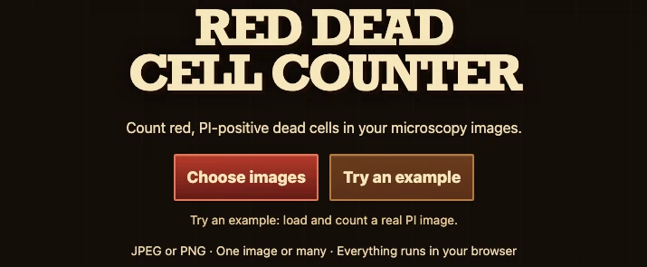
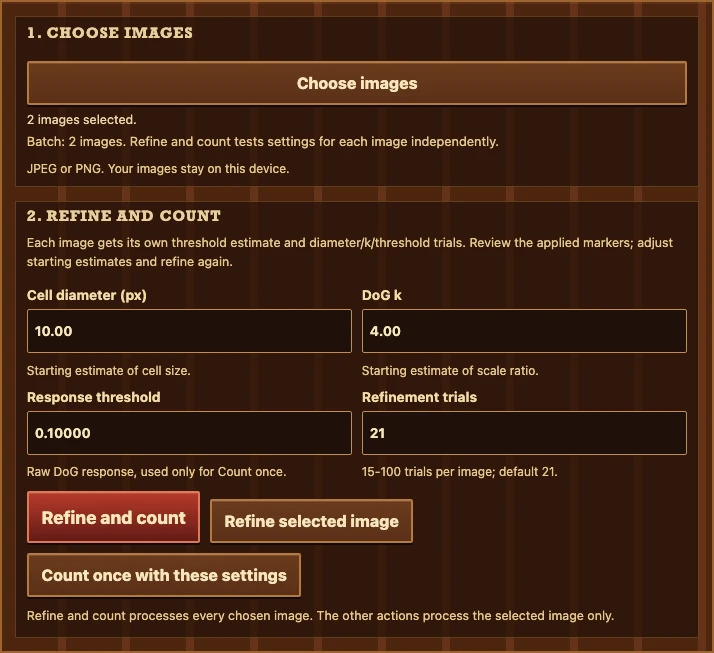
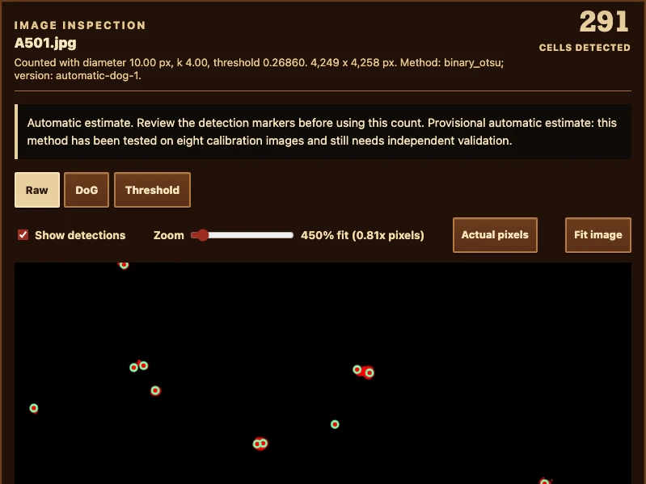

# Red Dead Cell Counter

Count red-stained cells in your browser, inspect the detection markers, and download a spreadsheet. Built for biology students and researchers, with automatic image-by-image thresholds and a Wild West saloon.

**[Step into the saloon: open the tool](https://vosslab.github.io/red-dead-cell-counter/)**

No installation or account needed. Your images stay on your device. Bring one JPEG
or PNG microscope image, or a whole image set.

**Automatic counts are provisional.** Inspect the markers before using a count.
The eight-image calibration still needs independent biological validation; see
[docs/AUTOMATIC_DETECTOR_EXPERIMENT.md](docs/AUTOMATIC_DETECTOR_EXPERIMENT.md).

## From microscope to bounty board

Choose your images, count the red objects, then check the evidence before exporting.
The saloon, wanted poster, and wooden bounty board keep the lab work on the frontier.

<!-- screenshots:begin (managed by screenshot-docs) -->

### 1. Choose your images

[](docs/screenshots/workflow_choose.webp)

Choose your JPEG/PNG files, or select **Try an example** to count a real field
immediately and skip to inspection.

### 2. Count the selected set

[](docs/screenshots/workflow_count.webp)

This example has two files selected. For your own file or set, select **Count cells**;
each image receives its own automatic cutoff.

### 3. Inspect, then save

[](docs/screenshots/workflow_inspect.webp)

Check the green center markers before **Download CSV**. This A501 example shows
**291** detections at cutoff **0.26860**; your images will have their own results.

<!-- screenshots:end -->

## Try your first count

1. [Open the tool](https://vosslab.github.io/red-dead-cell-counter/) and select
   **Try an example**. The real A501 image loads and counts immediately.
2. Inspect the green markers with **Zoom**, **Actual pixels**, and drag-to-pan.
   **Fit image** restores the overview.
3. Select **Download CSV** to save the count and the settings that produced it.

For your own files, select **Choose images**, open one or more JPEG/PNG images, then
select **Count cells**. Each image gets its own threshold. Select a filename on the
bounty board to inspect that image's saved result.

Follow [docs/WALKTHROUGH.md](docs/WALKTHROUGH.md) for a closer look at each screen,
the Raw/DoG/Threshold views, and a short touching-cells challenge.

## What you can do

- **Count a field or an image set.** The same actions work for one image or many.
- **Inspect each pick.** Green circles mark counted centers; white threshold regions
  show candidate pixels and can contain several centers.
- **Keep partial results.** Cancellation preserves completed and previously saved
  analyses. CSV includes attempt status, failures, review reasons, and actual settings.
- **Explore settings.** Optional **Advanced settings** offers manual analysis and
  15-100 comparison runs on the selected image.

Choosing a new file set replaces the current ledger. Download your results first.
Counts and overlays stay in memory for the current page.

## What does red mean?

This tool finds red fluorescent objects in propidium-iodide (PI) microscopy images.
Check the stain, acquisition conditions, and detection markers before drawing a
biological conclusion. A red-channel image alone gives neither a total-cell count nor
a percentage of viable cells. See
[Thermo Fisher's PI overview](https://www.thermofisher.com/us/en/home/life-science/cell-analysis/fluorophores/propidium-iodide.html).

## Follow your curiosity

- [docs/WALKTHROUGH.md](docs/WALKTHROUGH.md): take a guided first count, inspect, and export.
- [docs/USAGE.md](docs/USAGE.md): look up settings, CSV fields, recovery, and local setup.
- [docs/WORKFLOW_MODES.md](docs/WORKFLOW_MODES.md): understand one-image and batch behavior.
- [docs/AUTOMATIC_DETECTOR_EXPERIMENT.md](docs/AUTOMATIC_DETECTOR_EXPERIMENT.md): read method evidence and limitations.
- [docs/EXPERIMENT_DESIGN.md](docs/EXPERIMENT_DESIGN.md): understand Advanced comparison runs.
- [docs/VERIFICATION.md](docs/VERIFICATION.md): separate engineering checks from biological validation.

## For coders and curious students

The browser runs a TypeScript interface with Rust/Wasm image processing. To build
locally, install Node.js 26 with npm, current stable Rust with Cargo/rustup,
wasm-pack, and Python 3 for the local server. Then use the repository front doors:

```sh
npm ci
rustup target add wasm32-unknown-unknown
cargo install wasm-pack --locked
./run_web_server.sh
```

Open the printed local URL and select **Try an example**. For a production build
alone, run `./build_github_pages.sh`.
[docs/USAGE.md](docs/USAGE.md#build-and-check-locally) keeps the optional checks,
cache workaround, and Python characterization commands.

Read [docs/CODE_ARCHITECTURE.md](docs/CODE_ARCHITECTURE.md) and
[docs/FILE_STRUCTURE.md](docs/FILE_STRUCTURE.md) for the code map,
[docs/DETECTOR_EXPERIMENT.md](docs/DETECTOR_EXPERIMENT.md) for the DoG equations,
and [docs/WASM_PERFORMANCE.md](docs/WASM_PERFORMANCE.md) for measurements.
[docs/DESIGN_DECISIONS.md](docs/DESIGN_DECISIONS.md) records settled design;
[docs/CHANGELOG.md](docs/CHANGELOG.md) records dated changes.

## Credits and license

Jaren supplied the fluorescence images. The interface uses original frontier SVG art,
CSS wood and poster styling, and system fonts.

License text: [LICENSE.MIT](LICENSE.MIT) (MIT). Its copyright attribution is still unfilled.
