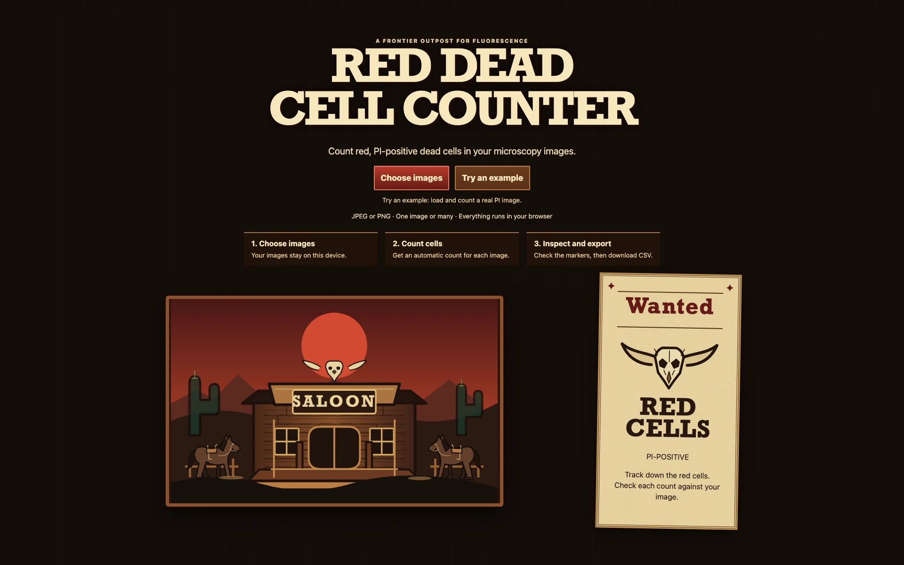
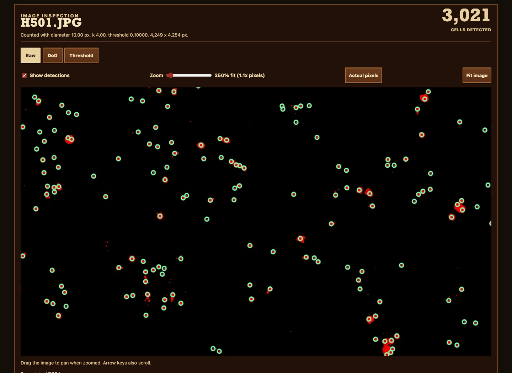

# red-dead-cell-counter

Count red, propidium-iodide-positive cells in fluorescence images without uploading research data to a server. Researchers can compare detector settings, inspect marked cells, and export plate-sized batch counts entirely in the browser.

[Open the GitHub Pages tool](https://vosslab.github.io/red-dead-cell-counter/)

A Western saloon entrance, wanted posters, wood panels, and original frontier artwork
set the scene for a Rust/WebAssembly Difference of Gaussians detector. JPEG and PNG pixels
stay on your device.

<!-- screenshots:begin (managed by screenshot-docs) -->


<!-- screenshots:end -->

- Inspect individual images with detection circles, fit-to-panel viewing, and zoom.
- Compare 15 central-composite cell-diameter, k, and threshold settings, with counts and runtimes.
- Auto-tune to the representative median run, or apply a comparison row yourself before batching.
- Process plate-sized batches sequentially and download CSV counts, settings, and errors.

## What the counts look like

The current shared default uses a 10-pixel diameter, k = 4, and response threshold 0.10.
Against eight supplied human counts, it has 12.5% mean absolute percentage error.
On the original six-image calibration set, tuning reduced that error from 31.0% to 11.6%:

| Image | Human count | Detector count |
| --- | ---: | ---: |
| A101 | 332 | 398 |
| A501 | 362 | 339 |
| B301 | 235 | 294 |
| C601 | 270 | 296 |
| E401 | 450 | 546 |
| F201 | 1050 | 1172 |
| H1001 | 745 | 785 |
| H501 | 2997 | 3021 |

These images are calibration data, not independent validation. Stable counts across nearby
settings indicate parameter robustness, not necessarily correct biological counts.

See [verification evidence](docs/VERIFICATION.md) for the current checks and their limits.

## Try an image, then a batch

1. Open the tool, select **Enter saloon**, and choose JPEG or PNG images.
   Select a row to inspect that image.
2. Choose **Analyze selected image** for a count with the current settings.
3. Choose **Compare settings** to run a 15-point central composite design around the current
   values. The table shows each count and runtime, highlights the actual tested run closest
   to the comparison median, and automatically applies that representative run.
   Progress feedback includes elapsed/remaining time; the final summary reports count
   range, mean, median, and population standard deviation across successful settings.
   Choose **Apply** on another row to use that result instead.
4. Choose **Analyze images** to apply the current settings to the entire selection, or
   **Auto-tune and analyze batch** to compare the selected image first and then batch.
5. Choose **Download CSV**. Every row records the settings actually used for that image.

The comparison uses eight factorial corners, six axial points, and one center.
For three factors its axial distance is alpha = 8^(1/4). Diameter, k, and threshold use
continuous logarithmic coordinates, so the tested settings stay proportional to the starting
point. Around the default starting values, the outer ranges are 5 to 20 pixels,
k = 2 to 8, and threshold 0.025 to 0.4.
At a boundary the log window recenters at the geometric mean while preserving the design.
The requested starting point and actual center/ranges remain visible. Custom positive thresholds
are accepted, including values below 0.001. Review the overlay before applying an image's
settings across a plate with different acquisition conditions.

## Build and run locally

Prerequisites: Node.js 26 with npm, current stable Rust with Cargo/rustup, and wasm-pack.

```sh
npm ci
rustup target add wasm32-unknown-unknown
cargo install wasm-pack --locked
./build_github_pages.sh
./run_web_server.sh
```

Open the local URL printed by the server, select **Enter saloon**, choose an image,
and select **Analyze images**.
The image panel will show detection circles and its table row will show a count.
Use **Actual pixels** for a 1:1 view, or zoom up to 6400% of the fitted view to inspect
individual picks. **Fit image** restores the overview; scroll within the image to pan.

On a managed machine where wasm-pack cannot write its default cache:

```sh
WASM_PACK_CACHE=/private/tmp/wasm-pack-cache ./build_github_pages.sh
```

The TypeScript 7 compiler runs alongside the official TypeScript 6 compatibility API
needed by ESLint. Dependency lockfiles record the installed npm and Cargo releases.

## How detection works

The browser decodes the image and transfers RGBA pixels to a worker. Rust extracts red
signal as `max(0, R - max(G, B)) / 255`, filters floating-point buffers, and returns
cell-center coordinates. Image processing uses `image`, `imageproc`, and `wasm-bindgen`.

The Gaussian scales follow equation 4 of Voss et al., *DoG Picker and TiltPicker*:

```text
sigma1 = radius * sqrt((k^2 - 1) / (2 * k^2 * ln(k)))
sigma2 = k * sigma1
```

## Documentation and checks

- [Experimental design and parameter ranges](docs/EXPERIMENT_DESIGN.md)
- [Real-image DoE and low-threshold results](docs/DOE_RESULTS.md)
- [Detector experiments and calibration](docs/DETECTOR_EXPERIMENT.md)
- [Verification results and limitations](docs/VERIFICATION.md)
- [Architecture and design decisions](docs/DESIGN_DECISIONS.md)
- [Human reference counts](docs/REFERENCE_COUNTS.csv)
- [Changelog](docs/CHANGELOG.md)

```sh
./check_codebase.sh
cargo test --manifest-path rust/Cargo.toml
./run_playwright_tests.sh
```

To reproduce the Python characterization, install the local development requirements,
then use the repository environment:

```sh
source source_me.sh && python3 tools/characterize_images.py
```

## GitHub Pages deployment

`build_github_pages.sh` produces the static `dist/` artifact, including the worker and Wasm
binary. The root [workflow seed](deploy-pages.yml) sets up Node 26, stable Rust, the browser
Wasm target, and wasm-pack before building and publishing `dist/`.
GitHub Actions runs the deployed workflow at `.github/workflows/deploy-pages.yml`; the
root seed remains the editable deployment template.

## Credits and license

Sample fluorescence images were supplied by Jaren. The interface uses CSS artwork and
system fonts for its frontier styling.

Source code: [MIT license](LICENSE.MIT).
