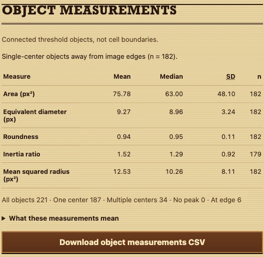
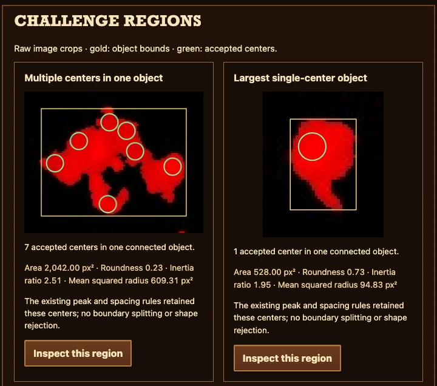

# Red Dead Cell Counter

Refine processing parameters, inspect detections, and count red PI-positive objects in microscopy images. Built for biology researchers, with image-by-image parameter trials in a Wild West saloon.

**[Step into the saloon: open the tool](https://vosslab.github.io/red-dead-cell-counter/)**

No installation or account needed. Your images stay on your device. Bring one JPEG
or PNG microscope image, or a whole image set.

**Parameter refinement is part of every normal count.** Each image gets its own
starting threshold and diameter/k/threshold trials. The tool applies a tested run
closest to the median count; inspect its markers and refine again if needed.
The combined refinement pipeline has no independent biological validation. The older
eight-image study covers its Otsu starting-threshold method only; see
[docs/AUTOMATIC_DETECTOR_EXPERIMENT.md](docs/AUTOMATIC_DETECTOR_EXPERIMENT.md).

## From microscope to bounty board

Choose images, refine their processing parameters, inspect the detected centers,
then save the ledger. The saloon, wanted poster, and wooden bounty board keep the
lab work on the frontier.

<!-- screenshots:begin (managed by screenshot-docs) -->
### 1. Choose your images

<a href="docs/screenshots/workflow_choose.webp"></a>

Choose your JPEG/PNG files, or select **Try an example** to refine a real field
immediately and continue to inspection.

### 2. Refine and count

<a href="docs/screenshots/workflow_count.webp"></a>

Review the starting diameter and k, then select **Refine and count**. Each image
gets its own threshold estimate and **21 parameter trials** by default.

### 3. Inspect, then save

<a href="docs/screenshots/workflow_inspect.webp"></a>

Check the green markers before **Download CSV**. This captured A501 result has
**272** detections at diameter **10.00 px**, k **2.65**, threshold **0.26860**.
This provisional parameter-sensitivity result represents the settings explored;
it does not establish accuracy.

## Measure objects and inspect clusters

<a href="docs/screenshots/object_measurements.webp"></a>

The paper ledger summarizes area, equivalent diameter, roundness, inertia ratio,
and mean squared radius for **single-center objects away from image edges**.
These threshold-object shapes approximate cells; they are not individually
segmented cell boundaries. Mean, median, SD, and finite sample size describe this
population, while the cohort counts include all connected objects. In this A501
result, **182** interior single-center objects have mean area **75.78 px&sup2;**,
mean roundness **0.94**, and mean squared radius **12.53 px&sup2;**.

<a href="docs/screenshots/challenge_clusters.webp"></a>

**Challenge regions** show real raw-image crops with gold object bounds and green
accepted centers. **Inspect this region** moves the main viewer to that object
without recounting. This H501 capture uses a separate manual count at diameter
10 px, k 4, and threshold 0.10000: **3,021** accepted centers. The illustrated
cluster retains **7 centers** in one object; it is not the default refined result.
**Download object measurements CSV** saves every connected object with its geometry,
coordinates, edge flag, accepted-center indices, and actual settings.

<!-- screenshots:end -->

## Refine your first image set

1. [Open the tool](https://vosslab.github.io/red-dead-cell-counter/) and choose one
   or more JPEG/PNG images. **Try an example** loads and refines the real A501 image.
2. Review the visible diameter and k starting estimates, then select **Refine and count**.
   Each chosen image runs independently through threshold estimation and parameter trials.
3. Read the trial statistics and inspect the green markers in **Raw**, **DoG**, and
   **Threshold**. Use **Actual pixels**, **Zoom**, and drag-to-pan to check faint
   objects, touching cells, and debris. **Fit image** restores the overview.
4. Adjust the starting estimates and select **Refine selected image** where needed.
   Select **Download CSV** after reviewing the results.

The response threshold box is for **Count once with these settings**, which directly
runs the three entered settings on the selected image. Automatic refinement computes
its own starting threshold. Diameter and k are starting estimates, not guaranteed
automatic measurements of cell size.

Follow [docs/WALKTHROUGH.md](docs/WALKTHROUGH.md) for the visual workflow and
[docs/USAGE.md](docs/USAGE.md) for control ranges and saved results.

## What you can do

- **Refine a field or image set.** Every image receives its own parameter exploration.
- **Inspect trial sensitivity.** Visible mean, median, SD, and count range summarize the
  tested settings; expand the trial table to inspect or apply a particular run.
- **Check each detection.** Green circles mark counted centers; white threshold regions
  show candidate pixels and can contain several centers.
- **Keep partial results.** Cancellation preserves completed and previously saved
  analyses. CSV records attempt status, failures, review reasons, and actual settings.

Selecting a ledger row restores that image's saved settings and refinement feedback.
Editing inputs leaves saved counts attached to the settings actually used.
Download before choosing a new file set or leaving the page. Counts, overlays, and
trial details stay in page memory. The count CSV saves totals and summary provenance;
the separate object CSV saves measured connected objects and their accepted-center indices.

## What does red mean?

This tool finds red fluorescent objects in propidium-iodide (PI) microscopy images.
Check the stain, acquisition conditions, and detection markers before drawing a
biological conclusion. A red-channel image alone gives neither a total-cell count nor
a percentage of viable cells. See
[Thermo Fisher's PI overview](https://www.thermofisher.com/us/en/home/life-science/cell-analysis/fluorophores/propidium-iodide.html).

## Workflow and method references

- [docs/WALKTHROUGH.md](docs/WALKTHROUGH.md): refine, inspect, and export an image set.
- [docs/USAGE.md](docs/USAGE.md): settings, CSV fields, recovery, and local setup.
- [docs/WORKFLOW_MODES.md](docs/WORKFLOW_MODES.md): one-image and batch processing scope.
- [docs/EXPERIMENT_DESIGN.md](docs/EXPERIMENT_DESIGN.md): parameter-trial design and median selection.
- [docs/AUTOMATIC_DETECTOR_EXPERIMENT.md](docs/AUTOMATIC_DETECTOR_EXPERIMENT.md): starting-threshold evidence and limitations.
- [docs/VERIFICATION.md](docs/VERIFICATION.md): engineering checks and validation boundaries.

## For developers

The browser runs a TypeScript interface with Rust/Wasm image processing. To build
locally, install Node.js 26 with npm, current stable Rust with Cargo/rustup,
wasm-pack, and Python 3 for the local server. Then use the repository front doors:

```sh
npm ci
rustup target add wasm32-unknown-unknown
cargo install wasm-pack --locked
./run_web_server.sh
```

Open the printed local URL and select **Try an example**. For a production build
alone, run `./build_github_pages.sh`.
[docs/USAGE.md](docs/USAGE.md#build-and-check-locally) keeps the optional checks,
cache workaround, and Python characterization commands.

Read [docs/CODE_ARCHITECTURE.md](docs/CODE_ARCHITECTURE.md) and
[docs/FILE_STRUCTURE.md](docs/FILE_STRUCTURE.md) for the code map,
[docs/DETECTOR_EXPERIMENT.md](docs/DETECTOR_EXPERIMENT.md) for the DoG equations,
and [docs/WASM_PERFORMANCE.md](docs/WASM_PERFORMANCE.md) for measurements.
[docs/DESIGN_DECISIONS.md](docs/DESIGN_DECISIONS.md) records settled design;
[docs/CHANGELOG.md](docs/CHANGELOG.md) records dated changes.

## Credits and license

Jaren supplied the fluorescence images. The interface uses original frontier SVG art,
CSS wood and poster styling, and system fonts.

License text: [LICENSE.MIT](LICENSE.MIT) (MIT). Its copyright attribution is still unfilled.
