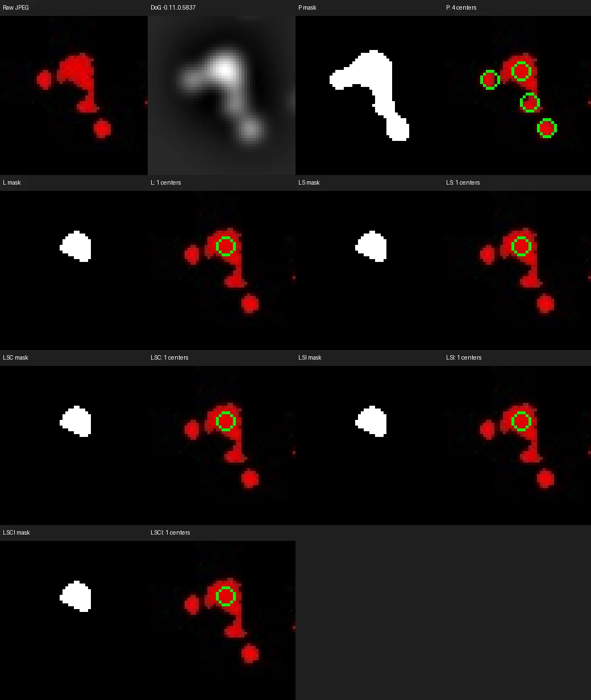

# Adaptive blob experiment

## Decision and scope

The 2026-11-12 experiment finds no qualifying adaptive policy. Retain the existing detector
and its default diameter 10 px, k=4, cutoff 0.10000. Local area refinement reduces aggregate
count disagreement at that cutoff, but fails the frozen nearby-cutoff retention rule. Adding
compactness or inertia does not earn its extra mechanism. No adaptive Rust/Wasm port, result
recipe, viewer mask, or CSV change follows from this result.

This completes the experimental decision under
[adaptive_blob_processing_plan.md](active_plans/active/adaptive_blob_processing_plan.md).
[adaptive_blob_processing_progress.md](active_plans/active/adaptive_blob_processing_progress.md)
records execution and final integration status. The broader
[automatic_image_counting_plan.md](active_plans/active/automatic_image_counting_plan.md) remains
open. Existing reusable Rust/Wasm geometry measurements remain available; they do not become
shipping cell-acceptance filters.

The question is whether local threshold searches, guided by component area and then shape,
improve count agreement on eight real JPEGs. The ImageJ totals in
[REFERENCE_COUNTS.csv](REFERENCE_COUNTS.csv) have human-stated +/-10% uncertainty. They are
calibration evidence, without independent cell locations or mask annotations. Better agreement
with these totals does not establish biological accuracy or successful clump separation.

## Frozen method

The run uses native Rust DoG responses, diameter 10 px and k=4, with strict 5-pixel baseline
non-maximum suppression and row-major plateau ownership. Diameter/k round to two decimals;
cutoffs round to five and compare inclusively as float32. Valid rounded cutoffs exceed 0.00001.
One response is reused per image. Detection accepts response pixels and baseline centers,
without filenames, reference rows, or human totals; scoring joins totals after all detections
have been saved.

At each base cutoff, label eight-connected foreground components. Let A0 be the median area
of components containing exactly one baseline pick. Freeze Amin=0.5*A0 and Amax=2*A0 across
all policies and local searches for that image/base cutoff. An empty one-pick reference set
preserves baseline output and reports insufficient size evidence. At the default cutoff,
A0 ranges from 95 to 157 square pixels; it is an image-derived scale, not a biological cell area.

The six policies form these ablations:

| Policy | Behavior |
| --- | --- |
| P | Preserve current picks and base threshold mask. |
| L | Inspect parents larger than Amax at higher local cutoffs. |
| LS | Add small-parent growth or persistent-small rejection. |
| LSC | Add compactness-triggered inspection and child compactness checks. |
| LSI | Add inertia-triggered inspection and child inertia checks. |
| LSCI | Trigger on either shape cue; require both enabled child checks. |

Large-parent searches stay inside the original parent mask. Inspect 1.25x, 1.5x, 2x, 3x,
and 4x cutoffs in ascending order. Select the lowest level whose nonempty child set has every
area in [Amin,Amax], then require the same child count and one-to-one containment at the next
level. Area and enabled shape checks apply at the candidate level; the next level establishes
persistence. A 4x level can validate 3x but cannot validate itself. Enabled compactness requires
C >= 0.8; enabled inertia requires a finite ratio <= 2. Place each child pick at its strongest
response pixel with row-major tie breaking. A single child is allowed to consolidate multiple
original picks. Failure preserves original picks and records the unresolved parent.

Small-parent processing precedes shape inspection and excludes those parents from upward
processing. Inspect distinct valid 0.75x and 0.5x cutoffs in descending order. Each lower global
component must contain exactly one original parent, counting zero-pick parents in ownership.
Growth may extend beyond the original mask but must reach [Amin,Amax]; it keeps the pick count.
Reject only after two distinct valid, uniquely owned lower levels both remain below Amin.
Ambiguous ownership, overshoot, or an insufficient cutoff floor preserves the original result
unless a valid growth level already qualifies. Selected upper cutoffs are not reprocessed.

Parent compactness below 0.8 or finite inertia above 2 triggers inspection rather than directly
rejecting a cell. Shape policies also constrain candidate children, so they can block an area
consolidation. This distinction matters to the observed higher counts with shape enabled.
Compactness uses Appion-style raster `4*pi*area/perimeter^2`; inertia is the major/minor
equal-weight binary covariance eigenvalue ratio. Neither uses intensity-weighted moments.
[BLOB_MEASUREMENTS.md](BLOB_MEASUREMENTS.md) defines the perimeter and degenerate-shape behavior.

## Evaluation rule

For human total H, use lower bound L=H/1.10 and upper bound U=H/0.90. For algorithm count C,
outside loss is `max(L-C, 0, C-U) / H`. Values below are percentages of H. The uncertainty band
is not a statistical confidence interval. Inclusive endpoints have zero loss; a lower point
error within the band earns no additional credit.

Keep a candidate only when default mean loss strictly decreases, at least two previously
out-of-band images improve, no in-band image leaves the band, worst loss does not increase,
and mean loss does not increase at either nearby cutoff. Ties favor fewer mechanisms.
Compare L/P, LS/L, each individual shape policy/LS, and joint shape/the better individual;
also check every overall candidate against P. Run all six policies on eight images at base
cutoffs 0.08, 0.10, and 0.12: 48 default and 96 nearby cases, 144 total.

## Default count results

Counts at base cutoff 0.10 use the same response and image-derived area bounds per image.

| Image | ImageJ H | P | L | LS | LSC | LSI | LSCI |
| --- | ---: | ---: | ---: | ---: | ---: | ---: | ---: |
| A101.jpg | 332 | 398 | 383 | 383 | 393 | 393 | 395 |
| A501.jpg | 362 | 339 | 334 | 318 | 321 | 322 | 321 |
| B301.jpg | 235 | 294 | 281 | 274 | 277 | 279 | 279 |
| C601.jpg | 270 | 296 | 281 | 271 | 276 | 274 | 277 |
| E401.jpg | 450 | 546 | 512 | 510 | 520 | 526 | 527 |
| F201.jpg | 1,050 | 1,172 | 1,127 | 1,104 | 1,124 | 1,131 | 1,131 |
| H1001.jpg | 745 | 785 | 765 | 757 | 762 | 762 | 762 |
| H501.jpg | 2,997 | 3,021 | 2,971 | 2,784 | 2,796 | 2,806 | 2,810 |

The default outside-loss summary is:

| Policy | Mean loss (%) | Worst loss (%) | In band / 8 |
| --- | ---: | ---: | ---: |
| P | 4.19 | 14.00 | 4 |
| L | 1.92 | 8.46 | 5 |
| LS | 1.88 | 5.48 | 4 |
| LSC | 2.59 | 7.26 | 4 |
| LSI | 2.83 | 7.61 | 4 |
| LSCI | 2.96 | 7.86 | 4 |

Nearby mean losses and band membership are:

| Policy | Mean at 0.08 (%) | In band / 8 | Mean at 0.12 (%) | In band / 8 |
| --- | ---: | ---: | ---: | ---: |
| P | 13.06 | 2 | 0.00 | 8 |
| L | 8.40 | 2 | 0.07 | 7 |
| LS | 7.33 | 2 | 0.61 | 6 |
| LSC | 8.92 | 1 | 0.52 | 7 |
| LSI | 9.53 | 2 | 0.45 | 7 |
| LSCI | 9.53 | 1 | 0.49 | 7 |

## Why every candidate fails

- L/P improves four previously out-of-band default images and passes the other default gates.
  It fails only 0.12 sensitivity: mean loss rises from zero to 0.07%. A501 falls from
  333 to 327, below its lower bound 329.09 (H=362). Six large-parent consolidations each
  change two picks to one: parent IDs 19, 40, 108, 118, 151, and 169.
- LS/L improves two previously out-of-band default images, but A501 moves from 334 (inside)
  to 318 (outside), and 0.12 mean loss increases.
- LSC/LS improves only one previously out-of-band default image; mean and worst default loss
  increase, and 0.08 mean loss increases.
- LSI/LS also improves only one such image, with higher default mean/worst loss and higher
  0.08 mean loss.
- LSCI/LSC improves no previously out-of-band default image, increases default mean/worst
  loss, and increases 0.08 mean loss. LSC is the better individual shape policy by default
  mean loss, but is itself rejected.
- Against P, every overall candidate fails 0.12 sensitivity; LS, LSC, LSI, and LSCI also
  move A501 outside its default band.

The eight in-band P results at 0.12 are sensitivity evidence from the calibration images.
They do not authorize changing the default or establish held-out accuracy. The current default
remains 0.10. Independent compactness, inertia, interaction/selection, and visual assessments
accept the negative outcome; an independent direct recomputation confirms every rejection.

## Visible failure and limits

The preserved example is an exact copy of generated `gallery/image_07_crop_02.webp`:



H501 crop bounds are [3567,1072,3619,1128] in original pixels, with right/bottom exclusive.
Green rings mark emitted centers; masks show the actual accepted pixels. The raw image shows
a hooked bright structure with adjacent lobes. P emits four centers; every adaptive policy
emits one after parent 628 selects local cutoff 0.30, validated at 0.40. Visible lobes lose
both markers and mask coverage. This is qualitative evidence of a risky consolidation,
without annotated local cell truth; neither four nor one is a validated biological count.

The gallery also covers the known hard H501 region beginning at [513,2299], plus A501 and
F201 examples. Those difficult clumps remain unresolved with unchanged local counts; there
is no supported claim that this experiment improves clump separation. Compactness and inertia
often preserve more picks by blocking area-driven consolidation. Count agreement alone cannot
decide which of those picks represents a cell.

## Reproduce and inspect

From the repository root, with the documented Python and native Rust dependencies installed:

```sh
source source_me.sh && python3 devel/benchmark_adaptive_blobs.py
```

The command reads eight JPEGs from `IMAGES/` and regenerates ignored
`generated/adaptive_blob_experiment/`. It builds the native release probe, freezes source/input
hashes, saves all detections, then joins references and writes scores. The run starts at
2026-11-12T15:52:38.324717+00:00. Its manifest records Python 3.12.16, NumPy 2.5.4,
SciPy 1.18.1, Pillow 13.0.0, and macOS arm64.

The generated artifacts are disposable and must be regenerated in another checkout:

| Artifact beneath generated directory | Meaning |
| --- | --- |
| `manifest.json` | Runtime, rules, eight input hashes, source hashes, invariance result. |
| `detections.json` | All 144 unscored case rows, saved before reading reference totals. |
| `results.csv`, `summary.json` | Scored rows, policy aggregates, and explicit gate failures. |
| `parent_decisions.csv` | 106,944 parent decisions, including unresolved/unchanged cases. |
| `cases/*.npz` | 144 compressed arrays of exact emitted xy centers. |
| `cases/*.json.gz` | 144 decision records with local cutoffs and frozen area bounds. |
| `gallery.json`, `gallery.html`, `gallery/*.webp` | Crop decisions and 46 quality-90 WebP panels. |
| `timings.json` | Wall times, shared preparation, and process high-water RSS. |
| `verification.json` | Independent 144-case/106,944-row audit and real-image rename/order check. |
| `report.md` | Generated brief summary; this document is the durable interpretation. |

The benchmark creates the detection/scoring/gallery artifacts. `verification.json` is the
separate independent audit receipt, rather than an output promised by the benchmark command.
The saved cases contain centers and decisions; masks are shown in crops and reconstructed by
rerunning the same policy, rather than persisted as 144 full-image arrays. The generated tree
occupies about 25 MB. Only the curated example above is preserved as a documentation asset.

The canonical source freeze uses these SHA-256 values; the generated manifest also retains
every input JPEG hash. Final source/input comparisons match the manifest.

| Source | SHA-256 |
| --- | --- |
| `devel/benchmark_adaptive_blobs.py` | `29303443a167159156f34f53891adc56ce7aca1b4e5763a5ce83d9305c5be109` |
| `devel/adaptive_blob_analysis.py` | `fd90cfa0e7db55ed686d4da9be3d328aa7c92e20a51d72b2ba1734c5daf4465d` |
| `devel/adaptive_blob_scoring.py` | `d3dc200ead5e12362cebf01a7e9b97cc0ac35e0d7a8270922608e0b7d48c053c` |
| `devel/adaptive_blob_gallery.py` | `19712dffb4e4538c01ef61f3006d827f0b1cff54383c8ee8dd204e03ce360271` |
| `devel/benchmark_thresholds.py` | `bf84f54356521bcb547d9d016de6ec2ecdec82722b30f82eac904e2e2d080fff` |
| `devel/measure_blob_areas.py` | `d6e34bcb414a01a20fb9037a0e162109ad572d52658b142804ef8d38267e1701` |
| `rust/examples/threshold_probe.rs` | `23164f55ede34987841dffd41071a89950bfedc9d22538bc96e6513c3d3d7f51` |
| `rust/src/lib.rs` | `4f1660f709c54b410030ef599a7cd07c1dc589f1a8768ffc4d9d90baaa40e987` |
| `rust/Cargo.lock` | `b2b4f9f677a2102080ff6e5a45b41b8090058b4d5e32074e4de7870753f01f0a` |

## Verification and performance

All eight P/default center arrays exactly match native Rust. The independent audit checks
all 144 saved cases and all 106,944 parent CSV rows, including emitted-center accounting.
A renamed real A101 JPEG produces the same native baseline and saved-policy outputs; copied
real pixels with reversed center and policy order also agree. No filename enters inference.

Specification review first identifies the missing float32 comparison at 0.08/0.12. After
the correction, a fresh specification review and quality review accept the implementation.
The complete 144-case rerun changes zero experiment outputs from the first run, while the
synthetic boundary regression now preserves peaks exactly equal to float32 cutoffs. The
two retained checks in `tests/test_adaptive_blob_contracts.py` cover that measured regression
and inclusive uncertainty-band/loss semantics. Sixteen temporary implementation checks pass
before removal at closeout; their passing status is one-time evidence.

The final run takes 38.55 seconds, including native probe calls, policy analysis,
case serialization, scoring, and gallery generation. Python high-water RSS is about 1.24 GB;
child-process high-water RSS is 364.53 MB (decimal units). Exact byte values remain in
`timings.json`. These are separate process measurements, not an additive simultaneous peak.
Per-policy timings share cached preparation/local trees and depend on execution order; they
are not a comparative speed benchmark or a browser performance measurement.

Regression receipts are in [VERIFICATION.md](VERIFICATION.md). The final retained pytest
suite passes 1,115 checks; pyflakes passes 50 checks; executable/shebang checks pass 171.
TypeScript type/lint/format checks, six DOE checks, 12 native Rust tests, the Pages build,
and five focused Chromium workflows pass. The
experiment changes research tools and records, with no product detector or UI change.
The `adaptive_integration_review` accepts final integration with no blockers after auditing all
144 cases, 106,944 parent rows, 46 gallery assets, nine source and eight input hashes, the exact
curated H501 image, and independent gate computations rejecting every policy. The reviewer did
not rerun the benchmark, browser workflows, Pages build, or native checks; scoped receipts remain
as reported in [VERIFICATION.md](VERIFICATION.md). M18 is complete; the broader automatic-counting
plan remains open.
