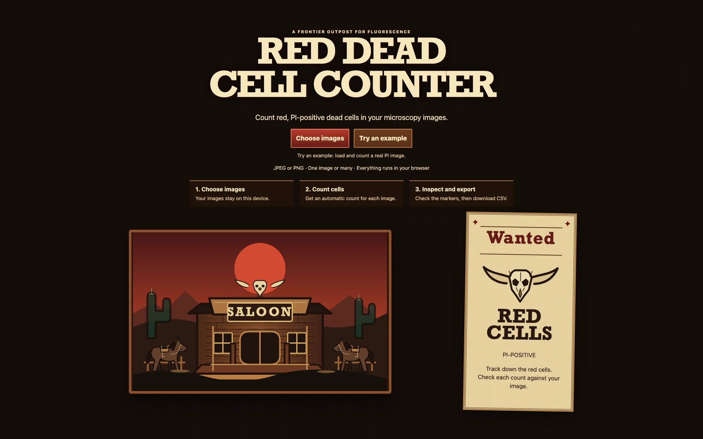
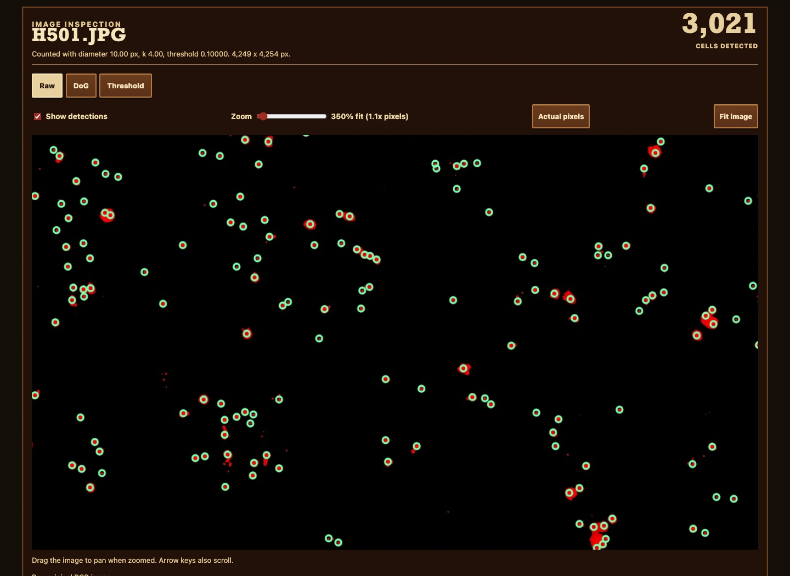
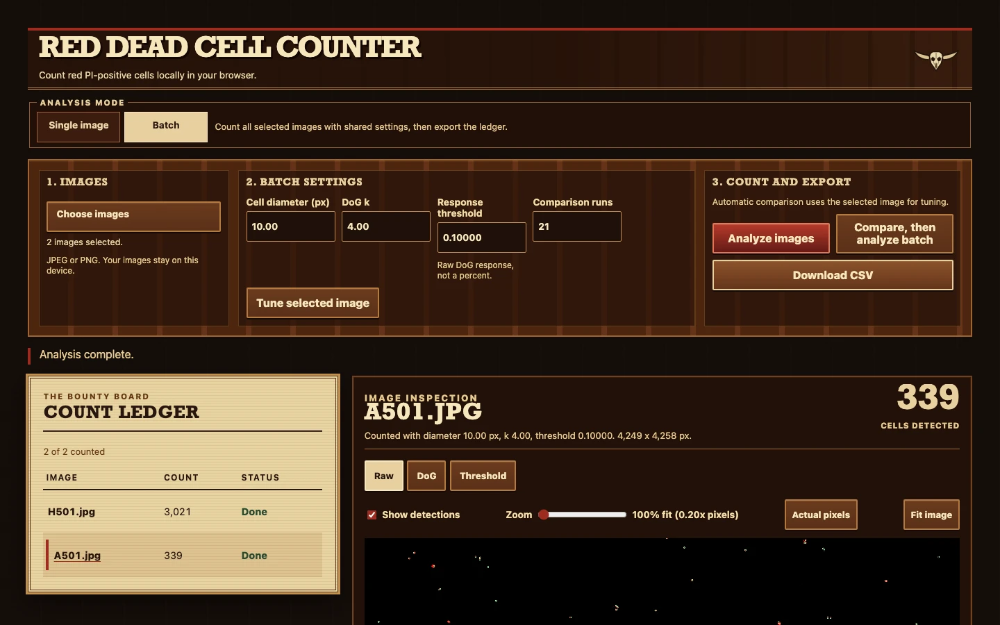
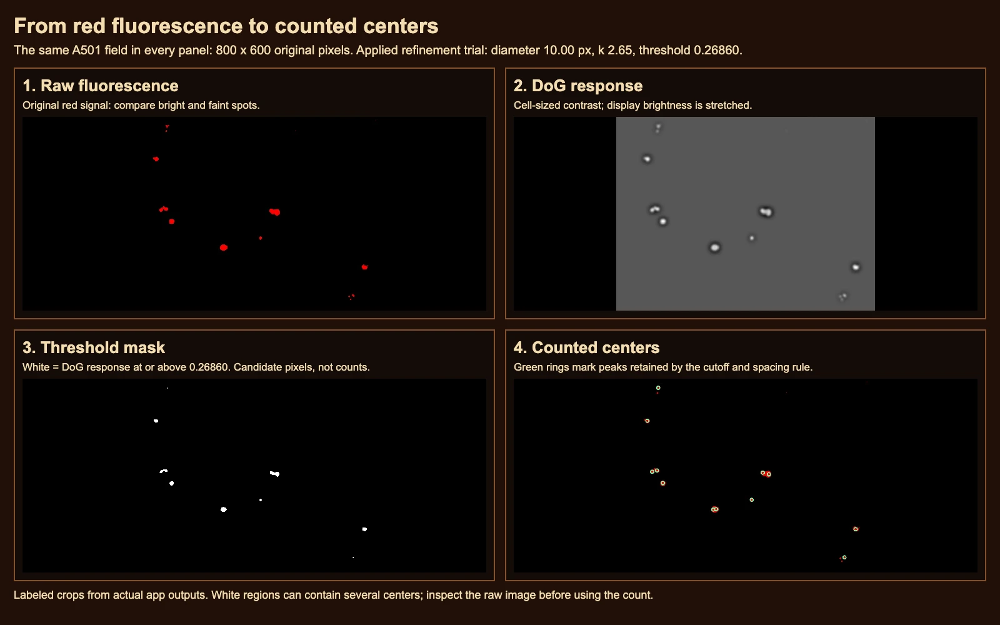
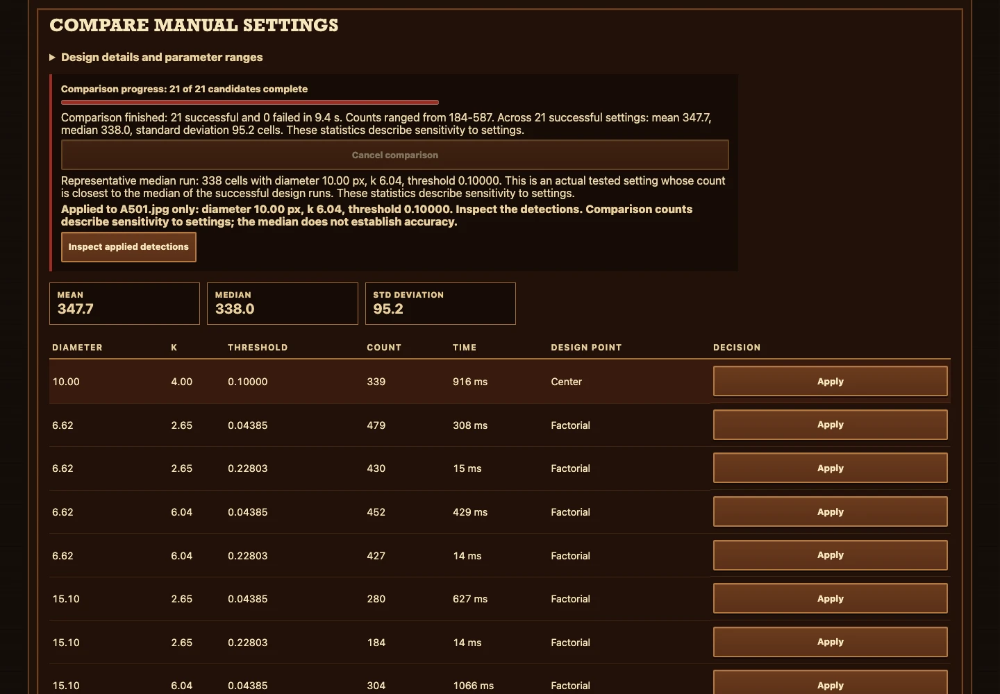

# A visual tour

Open [Red Dead Cell Counter](https://vosslab.github.io/red-dead-cell-counter/) and choose
images directly from the Western saloon, or select **Try an example**. No account or
installation is needed; image processing stays on your device.

The views below show the saloon, a real A501 automatic count, a two-image ledger,
the same A501 field through four processing stages, and an Advanced manual comparison.
Automatic counts remain provisional. Comparison statistics describe sensitivity to
settings rather than biological accuracy.

The processing guide follows an **800 x 600 pixel A501 field** with enough surrounding
cells to compare isolated and nearby spots. **Raw** preserves red fluorescence;
**DoG** emphasizes cell-sized contrast; **Threshold** keeps pixels at or above the
actual saved automatic cutoff. The final panel adds green circles at counted centers.
White regions are candidate pixels, not cell counts. These are labeled crops from
actual app outputs; they share exactly the same field and settings.

<!-- screenshots:begin (managed by screenshot-docs) -->





<!-- screenshots:end -->

For your own images, select **Choose images**, then **Count cells**. Inspect the markers
and select **Download CSV**. The number of selected images determines the processing
scope; there is no mode selector. Advanced manual analysis and comparison affect the
selected image only. See [USAGE.md](USAGE.md) and [WORKFLOW_MODES.md](WORKFLOW_MODES.md).

The captures come from the local production build and do not establish that the live
Pages deployment contains this revision. Reproduce them after building and serving:

```sh
node tests/playwright/capture_readme.mjs http://127.0.0.1:4193/
```

Replace the URL with the address printed by the local server. The harness writes WebP
at quality 90 and a capture receipt to `generated/readme_screenshot_capture.json`.
It checks actual binary/grayscale/color pixels, green overlays, comparison rows, and
two-image CSV metadata. [VERIFICATION.md](VERIFICATION.md) owns the full execution receipt;
[AUTOMATIC_DETECTOR_EXPERIMENT.md](AUTOMATIC_DETECTOR_EXPERIMENT.md) owns method limitations.
