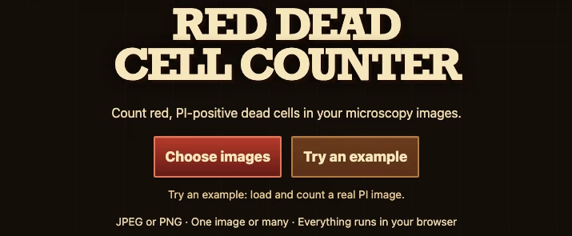
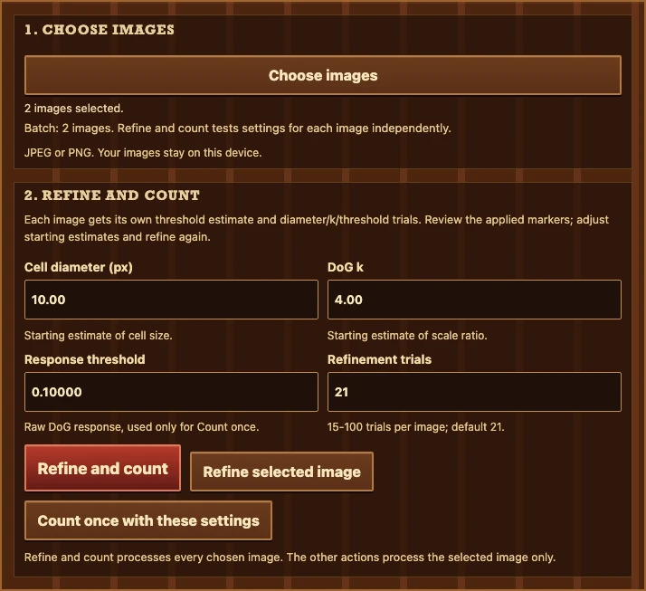
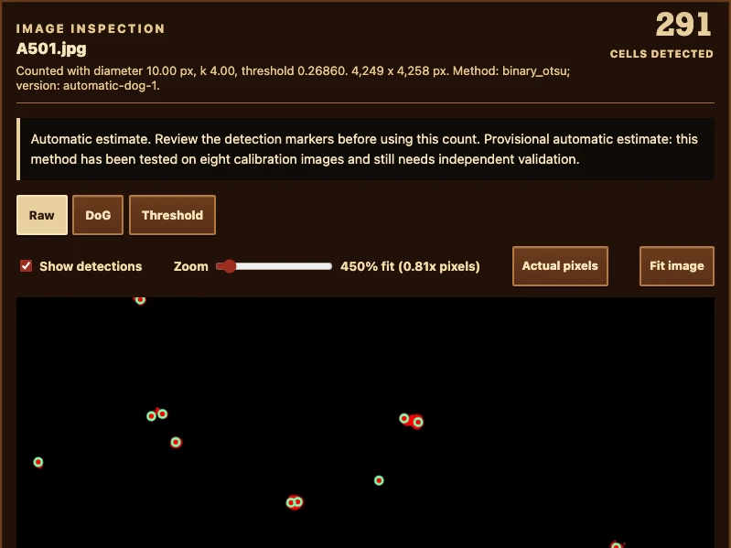
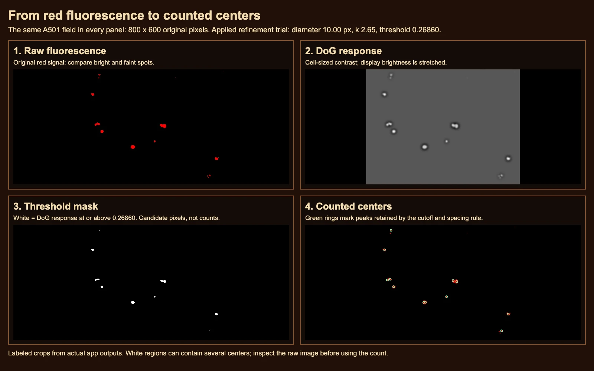
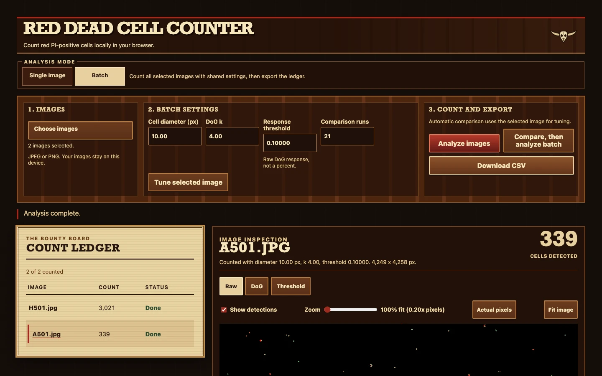
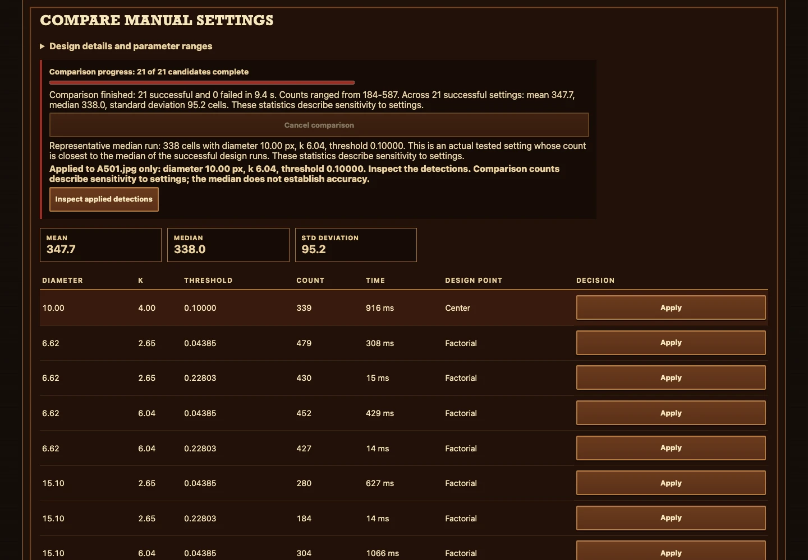

# Your first cell count

You will choose a microscopy image, inspect the red objects the tool counted, and
save a spreadsheet with the count and its settings. Open
[Red Dead Cell Counter](https://vosslab.github.io/red-dead-cell-counter/)
in your browser. You need no account or installation, and your images stay on your device.

Automatic counts are provisional. They were calibrated against uncertain human
ImageJ totals from eight images and still need independent biological validation.
Use the markers to decide where a count needs closer inspection.

<!-- screenshots:begin (managed by screenshot-docs) -->

## 1. Choose a field

Select **Try an example** to load the real A501 microscope image and count it
immediately. In the captured local build, it returns **291** detections with an
automatic cutoff of **0.26860**. You can explore the viewer without finding a file.

For your own images, select **Choose images** and open one or more JPEG/PNG files.
The workbench opens with your filenames on the wooden bounty board. Your files
wait for **Count cells**; choosing them alone does not start a count.

## 2. Count your images

This screen has two files selected and waiting. Select **Count cells** to process
them in sequence. You do not need to choose a mode or tune parameters first:
the tool fits a separate threshold to each image.

When counting finishes, the board shows counts and processing status. Select a
filename to open that image's saved result. Its count, actual settings, and review
notice belong to that image, even if you later change a control.

## 3. Inspect the centers

The green circles mark the centers the detector counted. Inspect a few bright
objects, faint objects, and touching spots against the original image. Read the
review notice: automatic results always carry provisional calibration status;
other notices can flag weak signal or sensitivity to the cutoff.

- Select **Actual pixels** to see original image pixels at their native size.
- Increase **Zoom**, then drag the image to pan between objects. Arrow keys,
  scrollbars, and touch scrolling also navigate the image.
- Toggle **Show detections** to compare the markers with unobscured fluorescence.
- Select **Fit image** to return to the overview.

The screenshot is a focused part of the workbench. Select an image in this guide
to open its full-resolution file; the following processing guide shows a larger field.

## Read the processing views

These panels follow the same **800 x 600 pixel A501 field** through the processing
stages. Compare the same isolated and nearby spots across all four panels.

The viewer tabs show different evidence from the same saved analysis:

| View | What you see | What to check |
| --- | --- | --- |
| Raw | Original RGB fluorescence. | Are the marked objects visible in the original image? |
| DoG | Cell-sized contrast emphasized by a Difference of Gaussians filter. | Which spots stand out from the background? |
| Threshold | White pixels whose response meets the saved cutoff. | Which faint spots or joined regions survive the cutoff? |
| Show detections | Green circles over the selected view. | Where are the counted centers? |

White regions are candidate pixels, not cell counts. One connected white region
can contain several counted centers. DoG contrast is stretched for display;
that display adjustment and switching tabs leave the saved count unchanged.

## 4. Save the ledger

Select **Download CSV** to save `dead-cell-counts.csv`. You can export one image,
a finished image set, or partial results. Each row includes the filename, dimensions,
count, attempt status/error, actual settings, algorithm/method, and review reasons.
Open the file in LibreOffice Calc or another spreadsheet program.

For an image set, inspect several rows rather than assuming the selected image's
cutoff applies to every file. You can select **Cancel counting** to stop a run:
completed analyses and previously saved results remain available. Failed or
cancelled recounts can retain an earlier count, labeled as a previous result with
its actual settings. CSV preserves that status alongside the saved analysis;
rows with no completed analysis have no count.

**Download before choosing a new file set or leaving the page.** A new selection
replaces the ledger, and counts/overlays live in page memory. CSV saves totals and
provenance, not the center coordinates or a reloadable analysis session.

## Optional: explore Advanced settings

After the automatic count, open **Advanced settings** if you want to explore how
the selected image responds to different choices. These actions affect the selected
image only:

1. **Count selected image with manual settings** uses the diameter, k, and response
   threshold you enter. The threshold is a raw DoG response, not a percentage.
2. **Compare settings on selected image** runs **15-100** manual trials (21 by
   default), summarizes the mean, median, and standard deviation, and applies a tested
   representative median run to that image.

Comparison replaces the selected result with a manual analysis, so its count can
differ from the initial automatic example. Similar counts measure sensitivity to the
settings tried; they do not establish biological accuracy or choose a batch recipe.
Inspect the resulting markers before exporting.

Changing diameter or k affects the next automatic run. Automatic counting computes
its own cutoff regardless of the manual threshold box. Editing controls keeps
existing results attached to the settings actually used. See [USAGE.md](USAGE.md)
for valid ranges and [EXPERIMENT_DESIGN.md](EXPERIMENT_DESIGN.md) for the trial design.

<!-- screenshots:end -->

## Try a biology challenge

Find an isolated red spot and a pair of touching spots in **Raw**. Turn off
**Show detections** and predict where you would put their centers. Turn detections
back on and compare your choices with the green circles.

Now switch to **Threshold**. Does one joined white region contain several centers?
Explain one agreement or disagreement using the original fluorescence, including
whether a faint object, a clump, or bright debris could affect the result.

The tool counts red fluorescent objects in propidium-iodide (PI) images. The stain,
acquisition conditions, and visible objects matter when you interpret them as cells.
A red-channel image alone does not supply a total-cell count or a percentage of viable
cells. See [Thermo Fisher's PI overview](https://www.thermofisher.com/us/en/home/life-science/cell-analysis/fluorophores/propidium-iodide.html).

## Why inspect every count?

Automatic counting emphasizes cell-sized contrast with a Difference of Gaussians
(DoG) filter, then selects a binary Otsu cutoff from each image's positive response.
The initial expected diameter is **10 px** and **k = 4**. The detector uses image
pixels; it does not look up filenames or reference counts.

On the eight calibration images, this automatic rule agrees better with uncertain
human totals than the former fixed 0.10 cutoff, while a fixed 0.12 cutoff agrees
better than the automatic rule. Faint objects can be missed. These comparisons do
not establish accuracy on a new experiment. Read the saved evidence in
[AUTOMATIC_DETECTOR_EXPERIMENT.md](AUTOMATIC_DETECTOR_EXPERIMENT.md).

## Where to go next

- [USAGE.md](USAGE.md): exact control ranges, CSV fields, and local setup.
- [WORKFLOW_MODES.md](WORKFLOW_MODES.md): saved results and processing scope.
- [EXPERIMENT_DESIGN.md](EXPERIMENT_DESIGN.md): the Advanced comparison design.
- [SCREENSHOTS.md](SCREENSHOTS.md): screenshot assets and recapture instructions.
- [README.md](../README.md): the project front door and credits.
